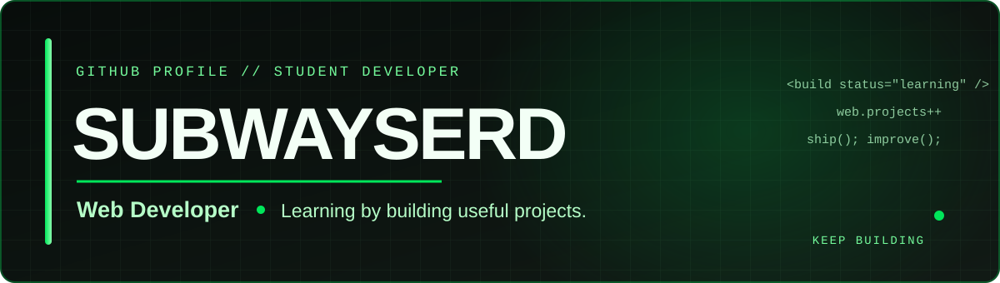

---

## About

- Student developer interested in building practical web projects.
- Currently improving my skills in front-end development and web application design.
- I enjoy turning real-world problems into simple digital tools.

## Featured project

### [Asrama 2026 — Portal Aduan Asrama](https://github.com/subwayserd-byte/asrama_2026)

A student project for submitting hostel reports, checking complaint status, and organising weekly room self-reports.

**Built with:** HTML · CSS · JavaScript · Google Apps Script · Google Sheets · Vercel

## Tools & technologies

---

*Thanks for visiting my profile.*

